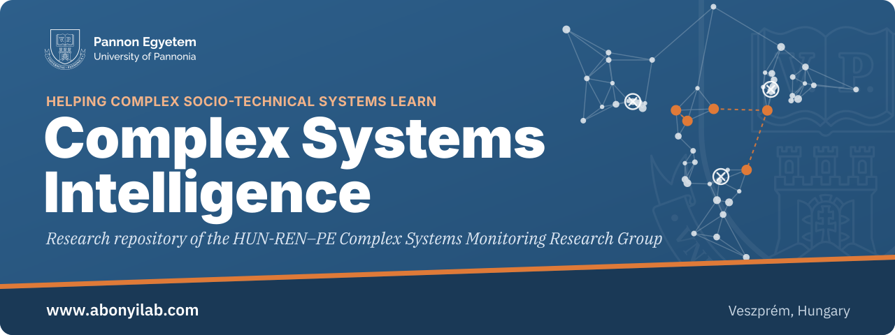
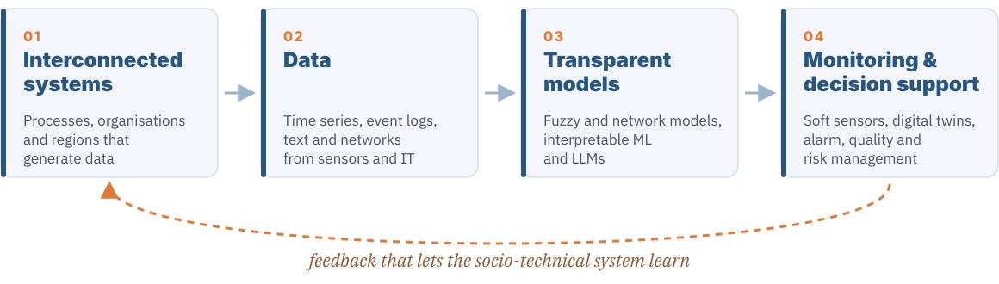
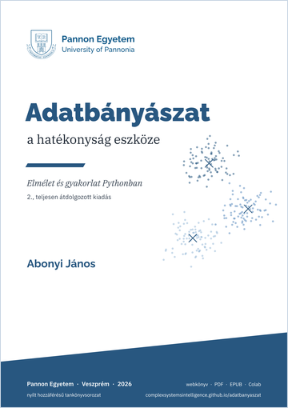
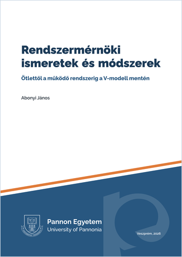

  
  
  
  
  
  
  

## About the group

**Complex Systems Intelligence** is the open-education and open-science repository of the
[**Complex Systems Monitoring Research Group**](https://www.abonyilab.com) (AbonyiLab) at the
[University of Pannonia](https://uni-pannon.hu), Veszprém, Hungary. The group was founded in 2017
within the Lendület programme of the Hungarian Academy of Sciences and has been supported by the
Hungarian Research Network ([HUN-REN](https://hun-ren.hu)) since 2022. It is led by
Prof. János Abonyi.

Our mission is **to help complex socio-technical systems learn**: we turn data from interconnected
processes, organisations and regions into transparent models, monitoring tools and decision
support — and we train the engineers and data scientists who build them. This account publishes
the open textbooks, interactive learning tools and reproducible notebooks that come out of this work;
the portal at [complexsystemsintelligence.github.io](https://complexsystemsintelligence.github.io/) leads to all of them.

<picture>
  <source media="(prefers-color-scheme: dark)" srcset="assets/mission-flow-dark.svg">
  
</picture>

## Open textbooks

Open-access university textbooks (in Hungarian), each published as a searchable web book with
printable PDF and EPUB editions, practice materials (browser apps or Excel templates) and Google
Colab notebooks that run with one click. Figures are drawn in TikZ, the worked examples are
reproducible from the repositories, and releases are archived on Zenodo with a citable DOI.

<table>
  <tr>
    <td align="center" valign="top" width="33%">
      
      <h3>Adatbányászat</h3>
      <em>Data Mining: Theory and Practice in Python</em> 
      2nd, fully revised edition
      
15 chapters on data preparation, clustering, association rules, predictive modelling, deep learning, anomaly detection, time series and text mining, with two running cases (an online shop and a process plant).

      
<a href="https://complexsystemsintelligence.github.io/adatbanyaszat/"><b>Web book</b></a> · <a href="https://complexsystemsintelligence.github.io/adatbanyaszat/adatbanyaszat.pdf">PDF</a> · <a href="https://complexsystemsintelligence.github.io/adatbanyaszat/adatbanyaszat.epub">EPUB</a> <a href="https://github.com/ComplexSystemsIntelligence/adatbanyaszat/tree/main/apps">14 practice apps</a> · <a href="https://github.com/ComplexSystemsIntelligence/adatbanyaszat/tree/main/notebooks">15 Colab notebooks</a> <a href="https://github.com/ComplexSystemsIntelligence/adatbanyaszat">Source</a>

    </td>
    <td align="center" valign="top" width="33%">
      
      <h3>Biztonságkritikus rendszerek</h3>
      <em>Safety-Critical Systems: Risk, Reliability and Functional Safety</em> 
      Handbook + practical guide
      
18 chapters from accident models, HAZOP, FMEA and STPA through fault trees, Markov models and SIL verification to safety cases, ML and cybersecurity, with three running industrial cases.

      
<a href="https://complexsystemsintelligence.github.io/biztonsagkritikus-rendszerek/"><b>Web book</b></a> · <a href="https://complexsystemsintelligence.github.io/biztonsagkritikus-rendszerek/kezikonyv/biztonsagkritikus-rendszerek.pdf">PDF</a> · <a href="https://complexsystemsintelligence.github.io/biztonsagkritikus-rendszerek/kezikonyv/biztonsagkritikus-rendszerek.epub">EPUB</a> <a href="https://complexsystemsintelligence.github.io/biztonsagkritikus-rendszerek/gyakorlat/">12 labs</a> · <a href="https://github.com/ComplexSystemsIntelligence/biztonsagkritikus-rendszerek/tree/main/gyakorlat/alkalmazasok">9 practice apps</a> · <a href="https://github.com/ComplexSystemsIntelligence/biztonsagkritikus-rendszerek/tree/main/gyakorlat/notebookok">7 Colab notebooks</a> <a href="https://github.com/ComplexSystemsIntelligence/biztonsagkritikus-rendszerek">Source</a> · <a href="https://doi.org/10.5281/zenodo.24413011">DOI</a>

    </td>
    <td align="center" valign="top" width="33%">
      
      <h3>Rendszermérnöki ismeretek és módszerek</h3>
      <em>Systems Engineering: From Idea to Working System along the V-Model</em> 
      Handbook + practical guide
      
26 chapters following the V-model from stakeholders and requirements through architecture, decision making, human-centred design and risk to verification, validation and operation, with three running cases.

      
<a href="https://complexsystemsintelligence.github.io/rendszermernokseg/"><b>Web book</b></a> · <a href="https://complexsystemsintelligence.github.io/rendszermernokseg/kezikonyv/rendszermernokseg-kezikonyv.pdf">PDF</a> · <a href="https://complexsystemsintelligence.github.io/rendszermernokseg/kezikonyv/rendszermernokseg-kezikonyv.epub">EPUB</a> <a href="https://complexsystemsintelligence.github.io/rendszermernokseg/gyakorlat/">55 method sheets</a> · <a href="https://github.com/ComplexSystemsIntelligence/rendszermernokseg/tree/main/gyakorlat/sablonok">54 Excel templates</a> · <a href="https://github.com/ComplexSystemsIntelligence/rendszermernokseg/tree/main/gyakorlat/notebookok">46 Colab notebooks</a> <a href="https://github.com/ComplexSystemsIntelligence/rendszermernokseg">Source</a> · <a href="https://doi.org/10.5281/zenodo.24414135">DOI</a>

    </td>
  </tr>
</table>

Texts are released under Creative Commons non-commercial licences and code under the MIT licence;
see each repository for details. Corrections and suggestions are welcome through the repositories'
Issues pages.

## Research areas

<table>
  <tr>
    <td valign="top" width="33%"><b><a href="https://www.abonyilab.com/ai-data-science">AI &amp; data science</a></b> Large language models, clustering and classification, fuzzy modelling, process mining, time-series and text mining, visualisation</td>
    <td valign="top" width="33%"><b><a href="https://www.abonyilab.com/industry-4-0-5-0">Industry 4.0 &amp; 5.0</a></b> Digital twins, Operator 4.0/5.0 and human aspects, indoor positioning, IoT, MES, production management</td>
    <td valign="top" width="33%"><b><a href="https://www.abonyilab.com/systems-engineering">Systems engineering</a></b> Process monitoring and control, soft sensors, data reconciliation, alarm, quality, safety and risk management</td>
  </tr>
  <tr>
    <td valign="top"><b><a href="https://www.abonyilab.com/network-science">Network science</a></b> Structural analysis, controllability and observability of complex networks</td>
    <td valign="top"><b><a href="https://www.abonyilab.com/optimization">Optimisation</a></b> Evolutionary and multi-objective optimisation, design of experiments, reinforcement learning, optimisation under uncertainty</td>
    <td valign="top"><b><a href="https://www.abonyilab.com/environment-sustainability">Sustainability</a></b> Environmental monitoring, sustainable development goals, circular economy, climate change</td>
  </tr>
</table>

## Software and data

<table>
  <tr>
    <td valign="top" width="24%"><b>Research code</b></td>
    <td valign="top"><a href="https://github.com/abonyilab">github.com/abonyilab</a>: <a href="https://github.com/abonyilab/NOCAD">NOCAD</a> (network-based observability and controllability analysis of dynamical systems), <a href="https://github.com/abonyilab/HAT-VIS_MATLAB">HAT-VIS</a> (hypergraph visualisation), <a href="https://github.com/abonyilab/Operator-4.0-Laboratory">Operator 4.0 Laboratory</a></td>
  </tr>
  <tr>
    <td valign="top" width="24%"><b>Monitoring software</b></td>
    <td valign="top">ObServML, a deployable Python application for compact and modular systems monitoring (<a href="https://doi.org/10.1016/j.softx.2026.102596">SoftwareX, 2026</a>)</td>
  </tr>
  <tr>
    <td valign="top" width="24%"><b>MATLAB toolboxes</b></td>
    <td valign="top"><a href="https://www.abonyilab.com/fclusttoolbox">Fuzzy Clustering and Data Analysis Toolbox</a> (Python successor under development), <a href="https://www.abonyilab.com/gp_index">GP-OLS genetic programming</a>, <a href="https://www.abonyilab.com/easy_iec">EASY-IEC interactive evolutionary computing</a> · <a href="http://www.mathworks.com/matlabcentral/fileexchange/authors/18034">MATLAB Central</a></td>
  </tr>
  <tr>
    <td valign="top" width="24%"><b>Open datasets</b></td>
    <td valign="top"><a href="https://springernature.figshare.com/articles/Metadata_record_for_A_multilayer_and_spatial_description_of_the_Erasmus_mobility_network/11687310">Erasmus mobility network</a> (<em>Scientific Data</em>, 2020) · <a href="https://doi.org/10.1016/j.dib.2021.106978">World news and SDG monitoring</a> (<em>Data in Brief</em>, 2021) · <a href="http://dx.doi.org/10.17632/23gwn43ygp.1">Regional Industry 4.0 readiness index</a> (2020)</td>
  </tr>
</table>

The full list of programs and datasets is on the [group website](https://www.abonyilab.com/about-us/software-and-data).

## Monographs

- J. Abonyi, L. Nagy, T. Ruppert: [*Ontology-Based Development of Industry 4.0 and 5.0 Solutions for Smart Manufacturing and Production*](https://doi.org/10.1007/978-3-031-47444-6). Springer, 2024.
- J. Abonyi, T. Czvetkó, G. M. Honti: [*Are Regions Prepared for Industry 4.0? The Industry 4.0+ Indicator System for Assessment*](https://doi.org/10.1007/978-3-030-53103-4). Springer, 2020.
- D. Leitold, Á. Vathy-Fogarassy, J. Abonyi: [*Network-Based Analysis of Dynamical Systems*](https://doi.org/10.1007/978-3-030-36472-4). Springer, 2020.
- T. Kenesei, J. Abonyi: [*Interpretability of Computational Intelligence-Based Regression Models*](https://doi.org/10.1007/978-3-319-21942-4). Springer, 2015.
- Á. Vathy-Fogarassy, J. Abonyi: [*Graph-Based Clustering and Data Visualization Algorithms*](https://doi.org/10.1007/978-1-4471-5158-6). Springer, 2013.
- J. Abonyi, B. Feil: [*Cluster Analysis for Data Mining and System Identification*](https://doi.org/10.1007/978-3-7643-7988-9). Birkhäuser, 2007.
- J. Abonyi: [*Fuzzy Model Identification for Control*](https://doi.org/10.1007/978-1-4612-0027-7). Birkhäuser, 2003.

## People and contact

**Head of group:** Prof. János Abonyi · **Deputy head:** Tamás Ruppert ·
**Lead researchers:** Alex Kummer (data science and systems engineering), László Gadár (network and
data science), Viktor Sebestyén (sustainability) — [all members](https://www.abonyilab.com/about-us/members)

We welcome PhD students, researchers and industrial partners: see
[open positions](https://www.abonyilab.com/about-us/open-positions) and
[trainings and services](https://www.abonyilab.com/about-us/trainings-and-services).

**Contact:** [janos@abonyilab.com](mailto:janos@abonyilab.com) · University of Pannonia, 10 Egyetem Street, H-8200 Veszprém, Hungary

---

  <a href="https://uni-pannon.hu"><picture>
    <source media="(prefers-color-scheme: dark)" srcset="assets/pe-logo-white.svg">
    
  </picture></a>

The research group is supported by the Hungarian Research Network (HUN-REN) and the National
Research, Development and Innovation Office (NKFIH), project OTKA 143482. The name, crest and logo
of the University of Pannonia are elements of the university's visual identity and are not covered
by the open licences of the repositories.
